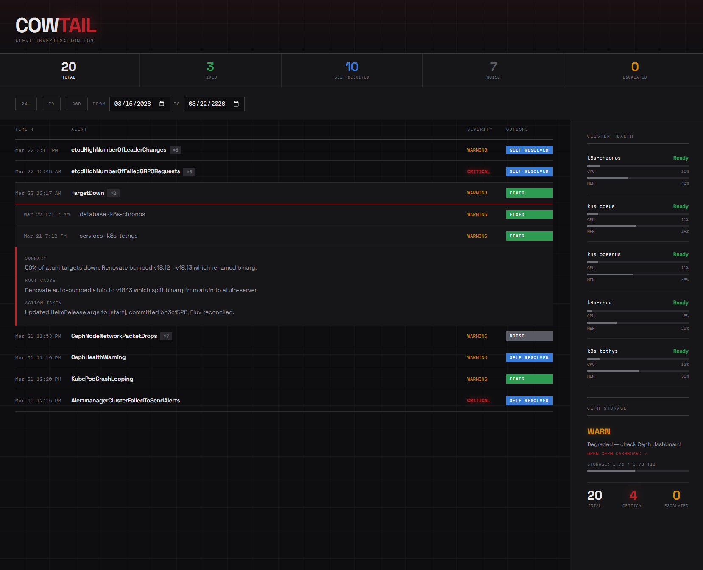

# Cowtail

Alert investigation log and cluster health dashboard for Kubernetes. Built to give visibility into what alerts fired, what caused them, and what was done about it.



> [!NOTE]
> Cowtail is a personal project built for a specific home lab setup. It's public so others can reference the patterns (nginx-proxied Convex, Prometheus cluster health, Alertmanager integration) but it's not designed as a general-purpose tool. Feel free to fork and adapt it to your own cluster.


This repo contains five projects:

- `cli/` contains the local command-line client
- `ios/` contains the native iPhone app and XcodeGen project
- `web/` contains the React app and Convex functions
- `protocol/` contains shared transport contracts and schemas
- `hermes-plugin/` contains the Hermes plugin that gives Hermes agents the `cowtail` tool

## Features

- **Signed-in web app** — the owner signs in with Pocket ID; without a session every page shows the login page, and item, alert and fix reads answer only the owner's session or a service token
- **Home** — what needs the owner, with Approve, Deny, Reply, Acknowledge and Snooze, what Hermes is on, cluster health, and what was handled in the last 24 hours
- **Cluster** — the alert pipeline's Watchdog state, node CPU/memory and readiness, Ceph storage, firing alerts by namespace, 7-day volume and the noisiest alerts
- **History** — outcome mix, time to resolve and noise rate over an item log grouped by day, with each item's fix; the filter lives in the address (`/history?q=&source=&kind=&outcome=&from=&to=`)
- **Item detail** — the item's timeline, details, links and linked fix at `/items/:id`
- **Settings** — quiet hours, urgency overrides, approval and roundup preferences, and Sign out
- **Roundup page** — shareable summary view at `/roundup?from=...&to=...`
- **PWA** — installable with custom icon

## Architecture

```
Browser ──→ nginx ──→ Static files (Vite build)
                  ├──→ /api/       → Convex backend (WebSocket sync + queries)
                  ├──→ /actions/   → Convex HTTP actions (alert writes)
                  └──→ /prometheus/→ Prometheus API (cluster health)
```

- **Frontend**: React + TypeScript + Tailwind CSS + Vite
- **Data**: [Convex](https://convex.dev) (self-hosted) — real-time sync via WebSocket
- **Queries**: TanStack Query + `@convex-dev/react-query`
- **Cluster health**: Prometheus queries proxied through nginx
- **Deployment**: Docker (nginx:alpine) on Kubernetes

## Setup

### Prerequisites

- Node.js, the version in `.node-version`, and pnpm, the version in `package.json`'s `packageManager`
- A [Convex](https://convex.dev) deployment (cloud or self-hosted)
- Prometheus (for cluster health panel)

### Development

```bash
pnpm install
cp web/.env.example web/.env
# Set COWTAIL_DEV_ACTIONS_URL to your Convex HTTP actions URL; `vite dev` proxies /actions to it
pnpm run dev:web
```

For container/runtime values, copy `web/.env.container.example` into your deployment environment and set the real upstreams there instead of hardcoding them in tracked nginx config.

The root install covers the CLI too. Run its commands from `cli/`, or use `pnpm run build:cli`, `pnpm run check:cli` and `pnpm run test:cli` from the root.

For iOS development, work from `ios/`, run `xcodegen generate`, and open `ios/Cowtail.xcodeproj`.

The Hermes plugin needs only Python 3.11 or later. Test it with `python -m unittest discover -s hermes-plugin/tests -v`, and install it by copying `hermes-plugin/` into the Hermes plugins directory.

### Deploy to Kubernetes

1. **Build the Docker image:**
   ```bash
   docker build -f web/Dockerfile -t cowtail .
   ```

2. **Set container environment variables** from `web/.env.container.example` for:
   - `CONVEX_API_UPSTREAM`
   - `CONVEX_ACTIONS_UPSTREAM`
   - `PROMETHEUS_UPSTREAM`
   - `UNIVERSAL_LINKS_APP_ID`

3. **Set environment variables** for the Convex HTTP actions:
   - `COWTAIL_WEB_ORIGIN` — your Cowtail URL (used in alert deep links)
   - `SITE_ORIGIN` — older name for `COWTAIL_WEB_ORIGIN`, read when that is unset
   - `PROMETHEUS_BASE_URL` — optional explicit Prometheus endpoint if it does not live behind `/prometheus`
   - `APNS_TOPIC` — the native app bundle identifier used for APNs
   - `APPLE_AUTH_AUDIENCE` — optional explicit Sign in with Apple audience override; defaults to `APNS_TOPIC`
   - `COWTAIL_WATCHDOG_MAX_SILENCE_MINUTES` — optional; how long the Alertmanager Watchdog may stay silent before Cowtail raises "Alert pipeline silent" (default `15`)
   - `COWTAIL_HERMES_HOOK_SECRET` — the shared secret Hermes signs its outbound webhooks with
   - `ALERTMANAGER_BASE_URL` — Alertmanager's API as Convex reaches it inside the cluster, such as `http://alertmanager.example:9093`. Maintenance windows silence alerts through it; unset, a window still holds back Cowtail's pushes and shows that the silence failed. No nginx route exposes it on the web origin.

4. **Optional: sign in with Pocket ID (OIDC).** Cowtail is single-owner, and Pocket ID signs in as the same owner as Sign in with Apple.
   - In Pocket ID, add an OIDC client that is confidential (not public), with PKCE enabled and the callback URL `<COWTAIL_WEB_ORIGIN>/actions/api/auth/oidc/callback`.
   - Find the owner's `sub`: in Pocket ID, open the owner's user; its ID is the `sub` the ID token carries.
   - Set all four of these on the Convex deployment, or none of them:
     - `OIDC_ISSUER_URL` — the Pocket ID base URL, `https://` only
     - `OIDC_CLIENT_ID` and `OIDC_CLIENT_SECRET` — from the client above
     - `COWTAIL_OWNER_OIDC_SUBJECT` — the owner's Pocket ID `sub`
   - `COWTAIL_OWNER_USER_ID` must already hold the owner's Sign in with Apple subject; a Pocket ID sign-in becomes that user. Every other Pocket ID user is refused.
   - `OIDC_DISPLAY_NAME` optionally renames the button; it defaults to `Pocket ID`.
   - With none set, the OIDC routes return 404. With only some set, they return 500 naming the missing ones.

5. **Optional: Sign in with Apple on the web.** The browser signs in as the same owner as the iOS app.
   - In the Apple Developer portal, create a Services ID, enable Sign in with Apple on it with the Cowtail App ID as its primary App ID, and register the Cowtail web domain and the return URL `<COWTAIL_WEB_ORIGIN>/actions/api/auth/apple/callback`.
   - Set `APPLE_WEB_SERVICES_ID` on the Convex deployment to that Services ID. Only the Apple account whose subject is `COWTAIL_OWNER_USER_ID` can sign in.
   - Unset, the login page offers no Apple button and the Apple web routes return 404.

6. **Deploy** using the HelmRelease in your GitOps repo, or any Kubernetes deployment method.

### Writing alerts

POST alerts to the Convex HTTP action endpoint:

```bash
curl -X POST https://your-cowtail-instance/actions/api/alerts \
  -H "Content-Type: application/json" \
  -d '{
    "alertname": "KubePodCrashLooping",
    "severity": "warning",
    "namespace": "default",
    "node": "worker-01",
    "status": "resolved",
    "outcome": "fixed",
    "summary": "Pod restarting due to OOM",
    "action": "Increased memory limit to 512Mi",
    "rootCause": "Memory limit too low for workload",
    "messaged": false
  }'
```

### Watching the alert pipeline

kube-prometheus-stack ships `Watchdog`, an alert that always fires. Route it to Cowtail's Alertmanager webhook (`/actions/api/alerts/webhook`, authorized with `COWTAIL_ALERTMANAGER_WEBHOOK_TOKEN`) with a short `repeat_interval`, so Alertmanager re-sends it every few minutes:

```yaml
route:
  routes:
    - receiver: cowtail-direct
      matchers:
        - alertname = "Watchdog"
      group_wait: 0s
      repeat_interval: 5m
```

Cowtail stores no alert for it. Each Watchdog records the pipeline's heartbeat, and `GET /api/health` reports it as `alertPipeline: { state, lastWatchdogAt }`, where `state` is `not_configured` before the first Watchdog, `ok` while they arrive, and `silent` once none has arrived for `COWTAIL_WATCHDOG_MAX_SILENCE_MINUTES`. While silent, Cowtail keeps one urgent `Alert pipeline silent` item open, and the next Watchdog resolves it. Keep `repeat_interval` well under the threshold.

### Hermes hook events

Hermes's outbound webhooks bring blocked kanban tasks, rate-limited kanban workers and model provider errors into Cowtail as items. Add this block to the Hermes host's `config.yaml`, and set `COWTAIL_HERMES_HOOK_SECRET` to the same value on the Hermes host and in the Convex environment:

```yaml
hooks:
  outbound:
    - name: cowtail
      url: https://your-cowtail-instance/actions/api/hermes/hooks
      events: [kanban_task_blocked, on_kanban_worker_exited, api_request_error]
      secret_env: COWTAIL_HERMES_HOOK_SECRET
```

| Event | Item |
|---|---|
| `kanban_task_blocked` | a question for today, one per task |
| `on_kanban_worker_exited` with `exit_kind: rate_limited` | a failure for today, one per provider or profile |
| `api_request_error` | a failure for whenever, one per provider and status; the tenth in an hour raises it to today |

Cowtail refuses a delivery whose `X-Hermes-Signature-256` does not match with 401, stores each `delivery_id` once, and answers every other event with 200.

### Notification sources

Each service that posts items is a registered source with its own token, display name and icon. Register one with the CLI, which prints its token once:

```bash
cowtail sources add deployer --name "Mac deployer" --icon deployer.png
```

The service then posts with `Authorization: Bearer cts_…` to `POST /actions/api/items`, and Cowtail sets the item's `source` from the token. A source token reaches only item ingest and its own items' events. `cowtail sources rotate` issues a new token and `cowtail sources disable` stops the source. The release seeds the built-in sources `alertmanager`, `hermes`, `cowtail` and `manual`, which post with the service token.

## Design

Swiss dark mode — dark background, red accents, Space Grotesk + DM Mono, grid precision.

## License

[MIT](LICENSE)
